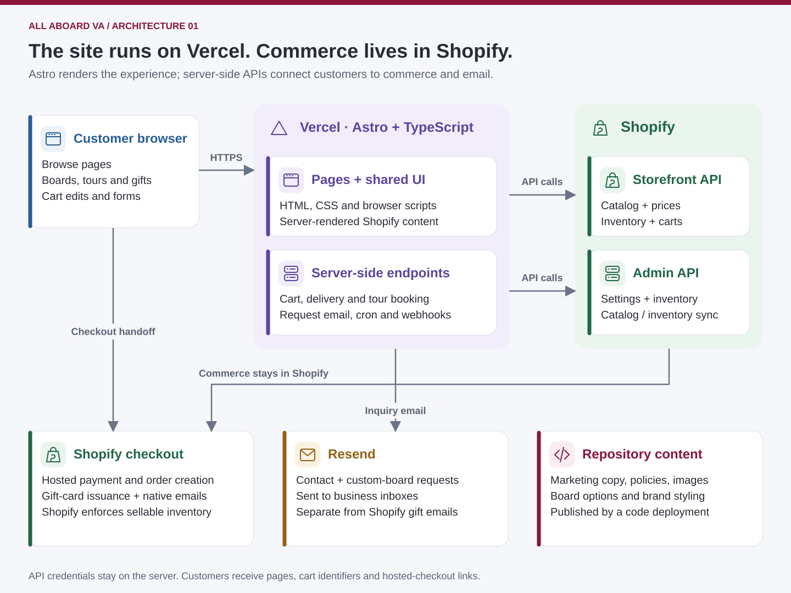
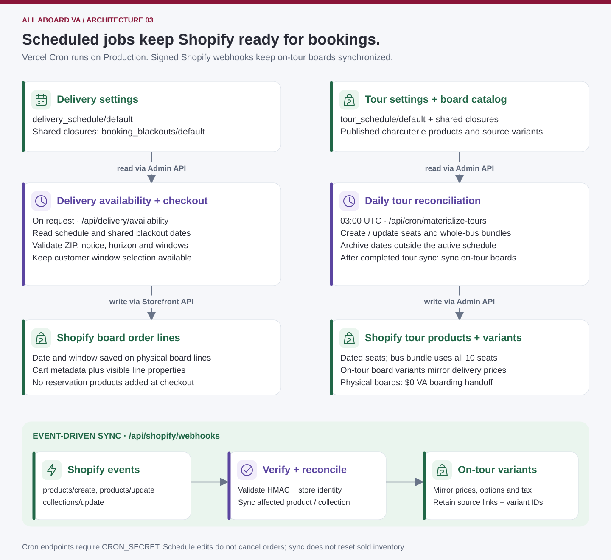
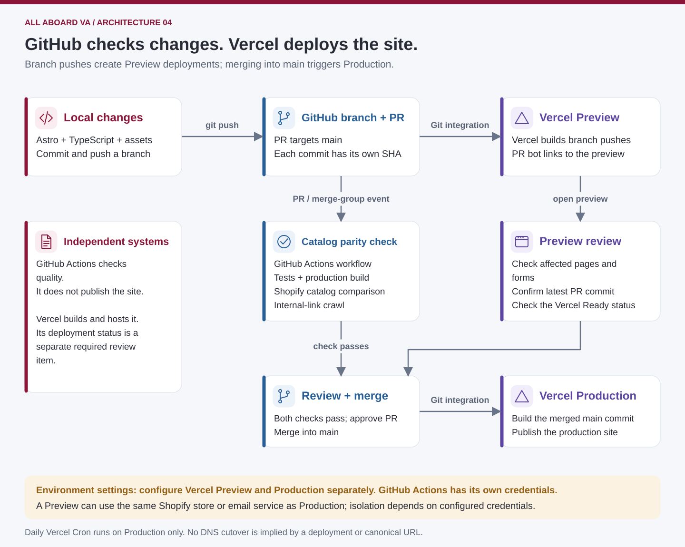

# All ABoard VA architecture

Astro owns the customer experience on Vercel. Shopify owns the commerce catalog, inventory,
carts, checkout, orders, and native gift cards. GitHub stores the application and runs checks;
Vercel builds and hosts Preview and Production deployments.

The four illustrations below render as graphics directly on GitHub. Click an image to open its
full-size SVG. They describe the implementation in this repository; external environment values,
webhook subscriptions, DNS cutover, and payment/email readiness require separate verification.

## 1. Runtime and service boundaries

[](architecture/runtime.svg)

The browser requests pages and calls same-site `/api/*` routes. Astro's server-side code calls
Shopify's **Storefront API** for published catalog data and carts, and its **Admin API** for
operational settings, delivery inventory, draft orders, and synchronization. API credentials stay
on the server.

- **Boards and gifts:** the product page adds a Shopify variant to a cart. The cart collects a
  delivery date/window for physical boards and hands customers to Shopify-hosted checkout.
  Gift-card-only orders skip delivery scheduling. Optional gift recipient/date details travel
  as Shopify's native cart-line properties; Shopify sends the gift-card emails.
- **Tours:** `/booking` collects the registration and board choices. Availability checks Shopify
  schedule settings and inventory. Checkout validates those choices and creates a Shopify cart
  containing the dated tour variant and any on-tour boards. Shopify handles payment and orders.
- **Custom boards:** `/custom-board-request` uses BotID verification and creates an Admin API draft
  order tagged for staff quoting. Staff sets the final price, reserves delivery capacity, and
  sends the invoice from Shopify; the form does not automatically complete a purchase.
- **Inquiries:** `/contact` posts to `/api/contact`, which uses Resend to send to the business inbox.
  This is separate from Shopify's order and gift-card notifications.

Sources: [Storefront client](../src/lib/shopify/storefront.ts),
[API authentication](../src/lib/shopify/client.ts), [cart API](../src/pages/api/cart.ts),
[tour booking service](../src/lib/shopify/tour-booking.ts),
[custom drafts](../src/lib/shopify/draft-orders.ts), [contact API](../src/pages/api/contact.ts).

## 2. Which Shopify components populate which pages?

[](architecture/page-data.svg)

| Page or component | Authoritative source | How it reaches the page |
| --- | --- | --- |
| Header announcement on all pages | `announcement_banner` metaobjects | Admin API; entry data cached for 60 seconds, announcement dates evaluated on every request |
| `/charcuterie-menu` and `/charcuterie-menu/p/*` | Published `charcuterie` collection, products, variants, images, descriptions, and `custom.*` product metafields | Storefront API during server rendering; on-tour variants are excluded from the regular catalog |
| `/gift-certificates` | First native gift-card product in the collection's manual order | Redirects to that product's local page; `isGiftCard` controls gift-specific UI, including active navigation |
| Gift-card amount selector | That gift-card product's variant prices | Storefront API; sorted numerically, no amount list maintained in the page |
| Gift-card price examples | Available charcuterie delivery variants plus `tour_schedule/default` prices | Storefront + Admin APIs; charcuterie grouped by serving count and rounded to the nearest $25; tour rows use configured prices |
| Planner on `/experiences`, then `/booking` | `tour_schedule/default`, `booking_blackouts/default`, dated tour products and their inventory | The planner opens booking; `/api/tours/availability` supplies live booking data, and `/api/tours/checkout` validates it again |
| Delivery selection on `/cart` | `delivery_schedule/default`, `booking_blackouts/default`, generated delivery-date inventory | `/api/delivery/availability` checks ZIP, schedule and remaining capacity; checkout revalidates the selection |
| Cart items, prices, quantities and checkout URL | Shopify cart | Browser calls `/api/cart`; server uses Shopify APIs and validates board/gift/delivery details |
| Homepage marketing copy and featured boards; About, FAQ, guides, policies and ingredient choices | Repository pages, data, styles and images | Deployed application files; these are not automatically rewritten by Shopify product changes |

The `/experiences` marketing cards contain repository-owned copy; the booking calendar and
checkout use Shopify data. The homepage also has Shopify-backed announcements, while its
featured-board selection/copy is curated in code. The guide omits unavailable source rows rather
than inventing fallback prices. If the native gift card cannot be loaded, `/gift-certificates`
shows a local inquiry page.

Sources: [content ownership guide](content-management.md), [header](../src/components/Header.astro),
[announcement loader](../src/lib/shopify/announcement.ts),
[gift guide](../src/components/GiftCardPriceGuide.astro),
[tour planner](../src/components/TourPlanner.astro),
[delivery availability](../src/pages/api/delivery/availability.ts).

## 3. Scheduled and event-driven Shopify updates

[](architecture/shopify-automation.svg)

Both cron schedules are defined in [vercel.json](../vercel.json) and run on **Production**.
They call server endpoints protected by `Authorization: Bearer <CRON_SECRET>`. Times are UTC;
Eastern wall-clock times change with daylight saving time.

| Trigger | Endpoint or process | Reads from Shopify | Writes back to Shopify |
| --- | --- | --- | --- |
| Daily **05:15 UTC** | `/api/cron/materialize-delivery` | Delivery schedule, shared blackouts, existing date products and inventory | Creates entering dates, reconciles capacity by delta, archives ineligible dates and reopens eligible dates; publishes to Headless |
| Daily **03:00 UTC** | `/api/cron/materialize-tours` | Tour schedule, shared blackouts, existing seats/bundles, charcuterie catalog | Reconciles dated seat products and whole-bus bundles; after a completed tour sync, reconciles on-tour board variants |
| Signed product-create/product-update webhook | `/api/shopify/webhooks` → `syncTourBoardProduct` | Affected charcuterie product, source variants, collection membership and fulfillment data | Creates/updates its on-tour counterparts and source relationships |
| Signed charcuterie-collection update webhook | `/api/shopify/webhooks` → `syncTourBoards` | Current charcuterie collection and variants | Reconciles on-tour counterparts across the collection |
| Authorized manual maintenance | Existing sync scripts or authenticated cron endpoints | Same authoritative settings and catalog | Reconciliation on demand; these operations can affect the configured live store |

A delivery date is represented by a hidden, $0, inventory-tracked Shopify variant; its stock
limits orders across that date's windows. A public tour date has ten seat units. Its private-bus
product is a bundle that needs all ten units, so public and private bookings share capacity.
On-tour board variants mirror their delivery counterpart's options, price, and tax settings but
do not require shipping.

These are reconciliation jobs, not nightly reimports: they preserve sold inventory and existing
variant relationships. Schedule edits do not cancel booked orders. Shared blackout checks read
the closure list directly at availability/checkout; nightly reconciliation also archives the
corresponding generated products. On-tour variants are managed by synchronization code rather
than edited as an independent price catalog. The tour job can report pending/busy work; board
sync waits until tour catalog reconciliation completes. Product webhooks verify HMAC and store
identity, run sync in the background, and stop writing once the product is already reconciled.
Other accepted webhook topics are logged; this handler does not implement order fulfillment or
refund processing for them.

Sources: [delivery cron](../src/pages/api/cron/materialize-delivery.ts),
[tour cron](../src/pages/api/cron/materialize-tours.ts),
[webhook handler](../src/pages/api/shopify/webhooks.ts),
[delivery reconciliation](../src/lib/shopify/schedule.ts),
[tour reconciliation](../src/lib/shopify/tours.ts),
[on-tour board sync](../src/lib/shopify/tour-board-sync.ts).

## 4. GitHub → Preview → Production

[](architecture/deployments.svg)

1. Commit changes on a branch and open a PR targeting `main`.
2. Vercel's Git integration builds branch pushes into **Preview** deployments. Use the Vercel
   bot comment's **Preview** link, and confirm its deployment commit matches the latest PR head.
3. Separately, GitHub's **Catalog parity** Actions workflow runs tests, an Astro production build,
   a Shopify catalog comparison, and an internal-link crawl. It runs on PRs to `main`, merge
   groups, and manual dispatch. **GitHub Actions does not publish the Vercel deployment.**
4. Review the changed pages and require both Catalog parity and the Vercel deployment check to
   pass. Merging the PR into `main` triggers Vercel's **Production** build and deployment.
5. Verify the production commit and affected routes. Production cron then runs according to
   `vercel.json`; PR previews do not automatically run those cron schedules.

Preview and Production have separately scoped Vercel environment variables. GitHub Actions uses
separately configured repository secrets/variables. A preview is **not inherently a Shopify
sandbox**: shared credentials can mean shared products, orders and email services. Deployment
status and canonical-domain metadata also do not prove that the Squarespace domain has been
pointed at Vercel.

Sources: [deployment workflow](deployments.md),
[Catalog parity workflow](../.github/workflows/catalog-parity.yml),
[Astro/Vercel adapter](../astro.config.mjs), [Shopify runbook](../SHOPIFY.md).

## Maintaining these diagrams

The SVGs are self-contained, use no external fonts or images, and work in GitHub Markdown as
ordinary images. Their editable source is [scripts/render-architecture.py](../scripts/render-architecture.py).
After changing an integration, schedule, data owner, or deployment workflow, update this guide
and the corresponding illustration, then regenerate all four:

```sh
python3 scripts/render-architecture.py
```

Review the generated SVGs visually before committing. Keep `README.md` as the documentation
index, [content management](content-management.md) as the ownership guide,
[deployments](deployments.md) as the hosting workflow, and [SHOPIFY.md](../SHOPIFY.md) as the
integration runbook. This architecture guide is the graphical overview of those sources.
